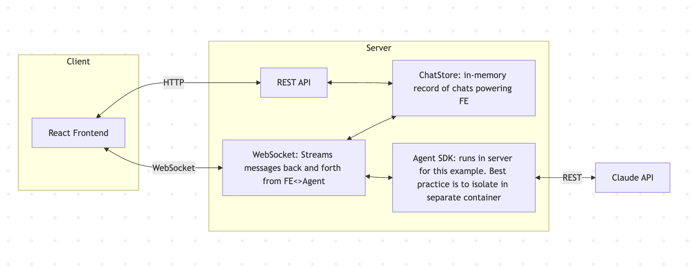
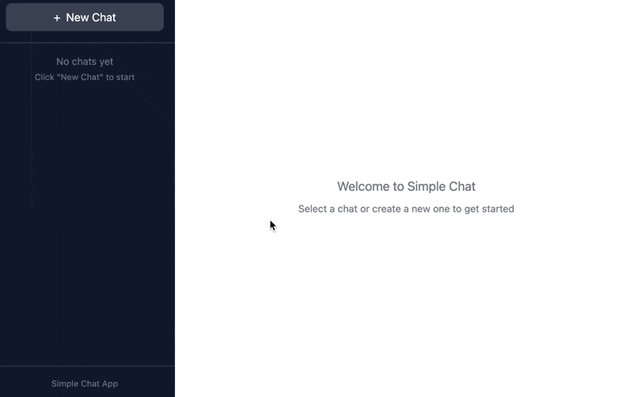

# Simple Chat App

A demo chat application using the Claude Agent SDK with a React frontend and Express backend.



## Getting Started

### Prerequisites

- Node.js 18+
- Claude Agent SDK credentials (set `ANTHROPIC_API_KEY` environment variable)

### Installation

```bash
npm install
```

### Running

```bash
npm run dev
```

This starts both:
- **Backend** (Express + WebSocket) on http://localhost:4111
- **Frontend** (Vite + React) on http://localhost:5173

Open http://localhost:5173 in your browser.

## MCP Harness

Use the MCP harness to debug tools directly or run an explicit repo-team pipeline test.

### Agent-mode (default)

This validates the production flow:
- top-level agent delegates to `repo-knowledge`
- `repo-knowledge` calls `run_repo_knowledge_team_pipeline`
- backend worker pool runs file summarizers + context generation without nested subagents

```bash
npm run test:mcp -- --repo .
```

Optional flags:
- `--force-refresh` / `--no-force-refresh`
- `--timeout-ms 600000`
- `--output data/mcp-test-output-agent.txt`

### Tool-mode (low-level debugging)

```bash
npm run test:mcp:tool -- --repo .
```

Optional flags:
- `--with-writes` (runs manual debug fixture writes)
- `--reset-store` (calls `prepare_file_summaries_store`)
- `--include-directory` (includes `return_directory` output)
- `--output data/mcp-test-output-tool.txt`

### Transcript files

- Agent mode default: `data/mcp-test-output-agent.txt`
- Tool mode default: `data/mcp-test-output-tool.txt`

Agent mode transcript includes:
- surfaced SDK events
- tool use/input + tool result payloads
- repo-team pipeline verification
- artifact validation diagnostics

## Repo Team Pipeline Settings

Optional environment knobs (defaults shown):

- `REPO_TEAM_MAX_WORKERS=4`
- `REPO_TEAM_RETRY_LIMIT=1`
- `REPO_TEAM_RETRY_BACKOFF_MS=750`
- `REPO_TEAM_FILE_TIMEOUT_MS=120000`
- `REPO_TEAM_CONTEXT_TIMEOUT_MS=120000`
- `REPO_TEAM_CONTEXT_HEARTBEAT_MS=5000`

The backend emits websocket `repo_progress` events while the queue runs so the client can display live status.

## Production Considerations

This is an example app for demonstration purposes. For production use, consider:

1. **Isolate the Agent SDK** - Move the SDK into a separate container/service. This provides better security isolation since the agent has access to tools like Bash, file system operations, and web requests.

2. **Persistent storage** - Replace the in-memory `ChatStore` with a database. Currently all chats are lost on server restart.

3. **Transcript syncing** - For Agent Sessions to be persisted across server restarts, you'll need to persist and restore the SDK's conversation transcripts. The SDK maintains internal state for multi-turn conversations that must be synced with your storage.

4. **Authentication** - Add user authentication and authorization. Currently anyone can access any chat.

## Demo


